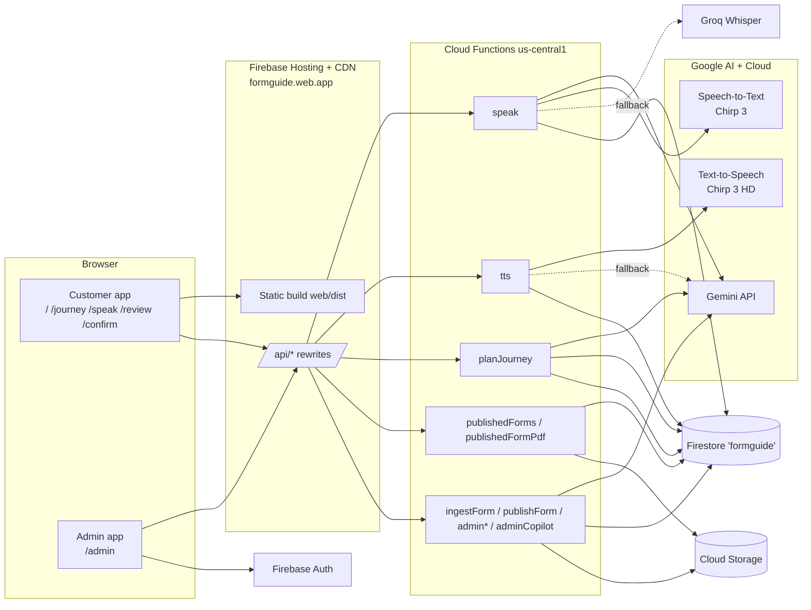
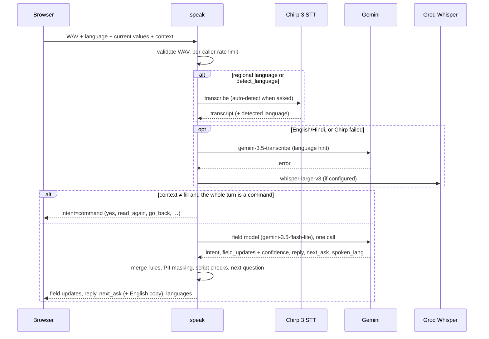
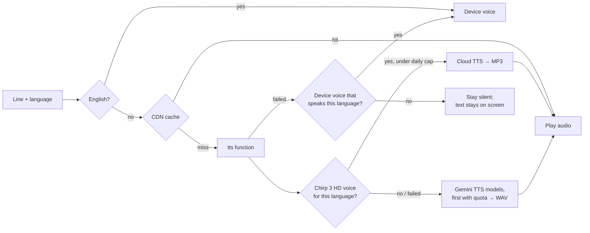
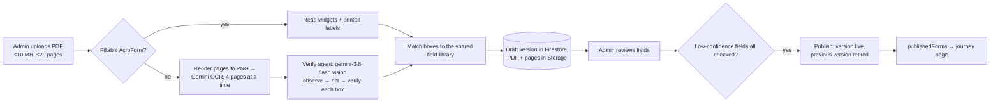

# Architecture

FormGuide is a single-page React app on Firebase Hosting, backed by twelve Firebase Cloud Functions. The functions call Gemini and Google Cloud speech APIs and store bank forms in Firestore and Cloud Storage. This document explains how the parts fit together. For running and deploying it, see [SETUP.md](SETUP.md).

## Design principles

- **Draft only.** Nothing is submitted to a bank. The customer confirms after a full read-back, and the result is a draft, a receipt and a filled PDF.
- **Voice first, any language.** Questions, answers to questions, and the read-back are spoken in the customer's language. The form itself is filled in English, as banks need.
- **The bank's own form.** Banks publish their real PDF through the admin console, and FormGuide fills those boxes. It never invents a form or a form number; UI copy says "Fields vary by bank".
- **Fail soft.** Every AI call has a fallback, such as a second model, a local extractor or a device voice. A failed call degrades one turn, not the session.
- **No customer accounts and no stored customer data.** A customer's draft lives only in their browser tab.

## System overview

Hosting serves the same build at two sites (`formguide` and `faceapp-5397b`) and rewrites `/api/<name>` to the function of that name. App routes are served `no-cache`, so a deploy reaches browsers at once; hashed assets under `/assets/` are cached for a year.

## Web app (`web/`)

### Customer flow

| Route | Page | What happens |
| --- | --- | --- |
| `/` | `LandingPage` | Product explainer, what to keep ready, languages, privacy |
| `/journey` | `JourneyPage` + `CompanionPanel` | Pick or detect the language. Describe the need by voice or text, and the **planner** proposes an ordered list of forms. Or pick a journey and a published bank form directly. |
| `/speak` | `SpeakPage` | Fill the form by voice: tap-to-talk or **hands-free**. Live field grid, missing-field prompts, "Check this" flags, agent trail, form preview. |
| `/review` | `ReviewPage` | Spoken read-back in the customer's language, voice corrections and questions, draft checks |
| `/confirm` | `ConfirmPage` | Three confirmation gates (plus "old card blocked" for card reissue), save draft, receipt, JSON and PDF download, next form in the plan |

`AppShell` provides the sticky header (language, **Admin login**) and the step bar.

### Key modules

| Module | Role |
| --- | --- |
| `session/FormSession.tsx` | The single source of truth for a draft: values, per-field confidence and provenance, language state (picked, heard, read-back language), the active form and plan, and the confirm gates. It runs voice turns (`voiceTurn`), speaks lines (`say`, `sayTurn`) and runs the read-back. It persists to `sessionStorage` and clears it when the tab closes. |
| `ui/useVoiceAgent.ts` | The hands-free loop: prepare (speak a question or the read-back), listen, send the clip, then speak the reply or run a command. Pages supply `prepare` and `onCommand`. It also powers tap-to-talk on Review and Confirm. |
| `ui/useMic.ts` + `lib/silence.ts` | Records 16 kHz mono WAV. In hands-free mode, an RMS-based detector with noise-floor calibration ends the clip about 1.3 s after the speaker stops. |
| `lib/tts.ts` | Speech output. English goes to the device voice. Hindi and regional languages go to server audio from `/api/tts`, cached in memory, retried once, and falling back only to a device voice that really speaks the language. |
| `lib/voiceLines.ts`, `lib/voiceLinesI18n.ts` | FormGuide's own spoken lines (prompts, confirmations, errors) in all twelve languages |
| `lib/readbackI18n.ts`, `lib/heuristicExtract.ts` | Read-back scripts per language, with dates spoken as "12 March 1994". `heuristicExtract` is also the local field extractor, used for typed text and when the model fails. |
| `lib/validate.ts`, `lib/draftChecks.ts` | Format checks (PAN, PIN, mobile, dates) and cross-field KYC rules, run before the read-back |
| `forms/activeForm.ts`, `lib/publishedForms.ts`, `lib/publishedPdfFill.ts` | The form being filled (the bundled HDFC v1, or a published bank form) and filling the bank's PDF in the browser with pdf-lib |
| `admin/*` | The admin app, lazy-loaded at `/admin`: console grouped by bank and journey, PDF upload, field review, copilot panel. `?mock=1` swaps the backend for in-browser mocks. |

## Functions (`functions/`)

All functions are HTTP (`onRequest`), deployed in `us-central1`.

| Function | Route | Caller | Purpose |
| --- | --- | --- | --- |
| `speak` | `POST /api/speak` | Public, rate-limited | One voice turn: transcribe, classify, extract fields, choose the next question |
| `tts` | `GET /api/tts` | Public, rate-limited, CDN-cached | One spoken line in Hindi or a regional language |
| `planJourney` | `POST /api/planJourney` | Public, rate-limited | Turns "what I need" into an ordered plan of journeys and forms |
| `publishedForms` | `GET /api/publishedForms` | Public | The published form catalog for the journey page |
| `publishedFormPdf` | `GET /api/publishedFormPdf` | Public | The source PDF of a published form, for in-browser filling |
| `ingestForm` | `POST` (called directly, not through the 60 s rewrite) | Admin | Upload a bank PDF and build a draft form version |
| `publishForm` | `POST /api/publishForm` | Admin | Publish a reviewed version and retire the previous live one |
| `adminForms`, `adminForm`, `adminFormPdf` | `GET /api/admin*` | Admin | Console data: rows and stats, one version, its PDF |
| `setFormStatus` | `POST /api/setFormStatus` | Admin | Unpublish (back to draft) or retire a version |
| `adminCopilot` | `POST /api/adminCopilot` | Admin | "Ask about your forms": Gemini with read-only tools |

Admin calls carry a Firebase ID token in `Authorization: Bearer`. The server verifies it and requires an allow-listed email (`shared/forms/cupAdmin.ts`) or the custom claim `admin: true`.

### Shared code

`shared/` holds code imported by both the web app and the functions: form types and the admin API contract (`shared/forms/*`), voice commands and contexts (`shared/voiceCommands.ts`), and the journey-plan types (`shared/journeyPlan.ts`). A few files cannot be imported across, so they are copied, and `npm run check:shared` keeps the copies identical.

## Key flows

### A voice turn (`POST /api/speak`)

The browser sends multipart form data with these parts:

| Part | Contents |
| --- | --- |
| `audio` | The WAV clip |
| `language` | The picked language |
| `current_values` | The draft's values as JSON |
| `context` | `fill`, `readback`, `review` or `confirm` |
| `form_fields`, `form_id` | The published form's bank-only boxes, when there are any |
| `detect_language` | Set when the page asks the server to detect the language |

That single field-model call does several jobs at once:

- **Classifies the turn** as an answer, a correction, a question or a command. Commands are recognised in any language; a fixed English and Hindi matcher catches the common ones before the model is called.
- **Extracts fields with confidence**, including the published form's own boxes.
- **Answers questions** ("What is CKYC?") briefly, in the customer's language.
- **Writes the next question** in that language.

The server then applies deterministic rules:

- Values are stored in Latin script.
- Aadhaar is masked to the last 4 digits, and a full card number is cut to its last 4.
- A model answer in the wrong script is dropped.
- A bare field id is never accepted as a question.
- Asking to "submit to the bank" is refused.

The browser applies the updates, marks fields below 0.75 confidence with "Check this", and speaks the reply and the next question.

### Spoken output (`GET /api/tts`)

How the server speaks a line:

- **Chirp 3 HD first.** Cloud Text-to-Speech answers in well under a second. It covers Hindi and most regional languages, but not Odia, Assamese or Sindhi.
- **Gemini text-to-speech as backup.** Five models are tried in order, and one that returns 429 is skipped for 10 minutes.
- **Cached by the CDN.** Responses are `public, s-maxage=604800`, so repeated lines such as the fixed questions are served by Firebase's CDN and never reach the function.

The browser never hands Hindi or regional text to an English voice: an English voice reads it as digits and commas only.

### Journey planning (`POST /api/planJourney`)

Gemini runs a function-calling loop over three tools:

- `list_journeys`
- `list_bank_forms`, which reads the published catalog
- `submit_plan`

The loop returns up to three ordered steps, a reply and a trace, or an "unsupported" outcome (for example loans or nomination). While the customer works through a plan, shared answers such as name, date of birth, mobile and address carry from one form to the next, and the confirm gates reset for each form.

### Bank form ingest and publish (admin)

How fields are judged:

- Fields above 0.85 confidence are accepted automatically.
- The rest must be checked by an admin before publishing; the server enforces this.
- Matches that only look alike are held for review rather than given a shared id.

### Admin copilot (`POST /api/adminCopilot`)

Gemini (`gemini-3.5-flash-lite`) uses read-only tools: `list_forms`, `form_coverage`, `usage_insights` and `find_duplicates`. A fifth tool, `propose_actions`, can suggest unpublishing or retiring a form. The server never changes anything itself: the console shows a proposal, and the admin confirms it.

## Languages

| Language | Speech in | Questions and read-back | Spoken by |
| --- | --- | --- | --- |
| English | Gemini transcribe | English | Device voice |
| Hindi | Gemini transcribe | Hindi tables + model | Chirp 3 HD |
| Bengali, Marathi, Telugu, Gujarati, Kannada, Punjabi | Chirp 3 | Model questions; app lines in `voiceLinesI18n.ts`; read-back in `readbackI18n.ts` | Chirp 3 HD |
| Malayalam (preview) | Chirp 3 | Same | Chirp 3 HD |
| Odia, Assamese (preview) | Chirp 3 | Same | Gemini TTS (no Chirp voice) |
| Sindhi (preview) | Gemini transcribe (no Chirp model) | Same | Gemini TTS |

The Preparation page can ask the server to detect the language from the first answer (Chirp `auto`). After that, the picked language is always sent as the transcription hint: an unhinted guess on real microphone audio produced made-up transcripts. Stored values stay in English or Latin script whatever the language.

## Data

| Store | Path | Contents |
| --- | --- | --- |
| Firestore `formguide` (Native) | `forms/{formId}/versions/{version}` | A form version: bank, journey, status (`draft`, `published` or `retired`), fields with geometry, schema ids and review state |
| | `rateLimits/*` | Per-caller rate-limit windows and the daily speech-character total, with an expiry time |
| | `insights/*` | One aggregate document per day: anonymous counts of speak turns by language, form and missing field, with no transcripts |
| Cloud Storage | `forms/{formId}/versions/{version}/source.pdf` | The uploaded PDF |
| | `forms/{formId}/versions/{version}/pages/{n}.png` | Rendered pages for review |
| Browser `sessionStorage` | `formguide.cup.session.v2` | The customer's draft. Removed when the tab closes. |
| Bundled | `web/src/forms/hdfcV1*.ts` (copied to functions) | HDFC v1, the default form and the source of the shared schema |

The field schema `aof_kyc_demo_v1` lives in `docs/schema/`, with the app's working copy in `web/src/schema/`.

## Security and privacy

- **No customer data at rest on the server.**
  - Audio sent to Gemini is uploaded to the Files API and deleted after the turn.
  - Transcripts and values are not stored or logged.
  - The planner never logs the customer's text.
  - Usage insights are anonymous counters.
- **PII rules in code:**
  - Aadhaar is kept as the last 4 digits only, on screen, in storage and in downloads, including the quoted transcript.
  - A full card number becomes its last 4.
  - There are no OTP, PIN or CVV fields.
- **Keys.** Gemini and Groq keys live in Secret Manager. Cloud speech APIs use the function's service account. The web build contains only the Firebase web config.
- **Admin.** Every admin endpoint verifies a Firebase ID token against the allow-list or admin claim. Publishing is gated on review server-side, not only in the UI.
- **Prompt hygiene.** Bank PDF labels are passed to the model as fenced data and never as instructions.

## Limits and cost controls

| Control | Value | Where |
| --- | --- | --- |
| Speak and planner, per caller | 150 requests per 10 minutes, per hashed IP address | `rateLimit.ts` |
| Speech lines, per caller | 600 per 10 minutes | `tts.ts` |
| Chirp 3 HD characters, all callers | 300,000 per UTC day (`TTS_DAILY_CHAR_CAP`); the first 1M a month are free | `tts.ts` |
| Line length | 700 characters | `tts.ts` |
| Audio clip | 45 s, 16 kHz mono WAV, at most 2 MB | `wav.ts`, `useMic.ts` |
| PDF upload | 10 MB, 20 pages | `shared/forms/limits.ts` |
| Throughput | Low `maxInstances` per function, which caps worst-case spend | each `onRequest` |

The limiter fails open: if Firestore is unreachable, the turn proceeds. Total spend is bounded by function throughput and the project budget alert, not by a shared quota that could be drained with forged addresses.

## Testing

- **Web:** Vitest with Testing Library (`web/src/**/*.test.ts(x)`). This covers pages driven by a fake mic and scripted `/api/speak` replies, end-to-end hands-free runs, speech-voice selection, silence detection, voice lines in every language, and validation. `scripts/form-version.parity.test.ts` checks the bundled form against the schema.
- **Functions:** `node:test` with `fetch` stubbed, so tests never reach the network. This covers the speak contract and intents, merge rules, PII, speech fallbacks and caps, ingest (OCR, verify agent, matching, version size), publish gates, admin auth, the planner and the copilot.
- **Before every merge:** `npm test`, `npm run test:functions` and `npm run check:shared`.

## Known limitations

- Malayalam, Odia, Assamese and Sindhi recognition is less reliable, and these languages are marked preview in the UI. The regional voice lines need review by native speakers.
- Gemini speech and preview text-to-speech quotas are small on the current key. Under heavy use, speech falls back to slower models or, with no matching device voice, to silence.
- Hands-free mode depends on the browser allowing the mic and audio to restart between turns. iOS Safari has not been tested.
- The dev proxy has no `/api/adminCopilot` entry (see SETUP).
- Later journeys (nomination, loans, fixed deposits, NEFT) are out of scope for the current schema.
